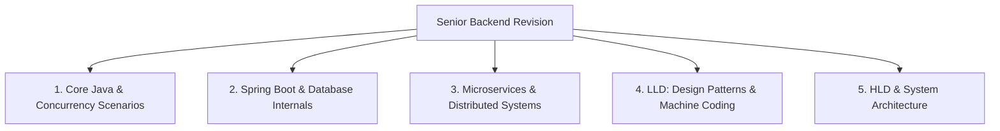

# Java, Spring Boot & Microservices Revision Plan (Discussion Notes)

## USER:
<USER_REQUEST>
ab main issue
mujhe revision karna hai for java springboot microservices
scenario based questions 
LLD HLD , computer fundamentals 
</USER_REQUEST>
<ADDITIONAL_METADATA>
The current local time is: 2026-10-26T19:35:14+05:30.

The user's current state is as follows:
Active Document: /Users/shubhamfarera/repos/job-hunter/naukri_apply.py (LANGUAGE_PYTHON)
Cursor is on line: 147
Other open documents:
- /Users/shubhamfarera/repos/job-hunter/naukri_auth.py (LANGUAGE_PYTHON)
- /Users/shubhamfarera/repos/job-hunter/stealth_connect.py (LANGUAGE_PYTHON)
- /Users/shubhamfarera/repos/job-hunter/.env (LANGUAGE_UNSPECIFIED)
- /Users/shubhamfarera/repos/job-hunter/naukri_external_jobs.csv (LANGUAGE_UNSPECIFIED)
- /Users/shubhamfarera/.gemini/config/mcp_config.json (LANGUAGE_JSON)
</ADDITIONAL_METADATA>

---

## ANTIGRAVITY:
8+ years experience aur 30+ LPA ke interviews me direct theory koi nahi poochta — **90% questions real-world production scenarios, failure handling, LLD, aur HLD par hote hain**.

Hum aapke revision ko **5 structured modules** me divide karenge. Aap jis module se start karna chahein bataiye, ya hum ek-ek karke scenario solve karna shuru karein:

---

### 🗺️ Revision Master Curriculum (Target: 30+ LPA Senior Backend)



---

### 📌 Module 1: Core Java & Concurrency (Production Scenarios)
1. **Memory & Concurrency**:
   - `HashMap` vs `ConcurrentHashMap` internal lock striping (Segment locking in Java 7 vs Synchronized bin trees in Java 8+).
   - `volatile` vs `AtomicInteger` vs `synchronized` vs `ReentrantLock` — kab kaun sa choose karein?
   - `CompletableFuture` chaining, exception handling (`handle` vs `exceptionally`), aur custom thread pool (`ThreadPoolExecutor`) sizing formula:
     $$\text{Threads} = \text{CPU Cores} \times \left(1 + \frac{\text{Wait Time}}{\text{Compute Time}}\right)$$
2. **Garbage Collection & Memory Leaks**:
   - G1GC vs ZGC: Garbage collection pause times reduce kaise karte hain?
   - OutOfMemoryError (`OOM: Java heap space` vs `OOM: Metaspace`) ka root cause analysis (heap dump profiling via JProfiler / VisualVM).

---

### 📌 Module 2: Spring Boot & Database Scenarios
1. **Transaction Pitfalls (`@Transactional`)**:
   - Self-invocation problem (Spring AOP proxy bypass kyun hoti hai?).
   - `Propagation.REQUIRED` vs `REQUIRES_NEW`: Child method fail hone par parent rollback hoga ya nahi?
   - External REST / Kafka call ko `@Transactional` ke andar rakhne se **HikariCP connection pool starvation** kaise hota hai?
2. **JPA & Hibernate Performance**:
   - **N+1 Problem**: `JOIN FETCH` vs `@EntityGraph` vs `BatchSize`.
   - Dirty checking mechanism aur First-level cache vs Second-level cache (Redis).
   - Optimistic Locking (`@Version`) vs Pessimistic Locking (`PESSIMISTIC_WRITE`) in high-concurrency balance deductions.

---

### 📌 Module 3: Microservices & Distributed Patterns
1. **Dual-Write Consistency**:
   - DB me order save hua par Kafka event publish fail ho gaya — is **Dual-write issue** ko **Transactional Outbox Pattern** (+ Debezium CDC) se kaise solve karte hain?
2. **Distributed Transactions**:
   - **Saga Pattern**: Orchestration vs Choreography. Compensating transactions kaise trigger hote hain?
3. **Resilience & Fault Tolerance**:
   - Circuit Breaker (Resilience4j) state transitions: `CLOSED` ➡️ `OPEN` ➡️ `HALF_OPEN`.
   - Rate Limiting: Token Bucket vs Leaky Bucket vs Sliding Window Log.
   - Idempotency in Payment APIs: `Idempotency-Key` header with Redis distributed lock.

---

### 📌 Module 4: Low-Level Design (LLD)
1. **SOLID Principles in Real Code**:
   - Open-Closed & Dependency Inversion in payment routing (Razorpay, Stripe, Paycraft).
2. **Classic LLD Problems for 8+ Yrs**:
   - Rate Limiter (Token Bucket implementation with Redis).
   - In-Memory Cache with LRU eviction policy (Doubly LinkedList + HashMap in $O(1)$).
   - Event-driven Notification Service (Email, SMS, Push notification router).

---

### 📌 Module 5: High-Level Design (HLD) & Computer Fundamentals
1. **Distributed Architecture**:
   - CAP Theorem trade-offs in real life (e.g. Cassandra vs MongoDB vs PostgreSQL).
   - Caching strategies: Cache-Aside vs Write-Through vs Write-Back. Cache Stampede / Thundering Herd prevention.
   - Database Sharding vs Partitioning vs Read Replicas (Replication lag handling).
2. **Computer Fundamentals**:
   - **OS**: Process vs Thread, Context Switching overhead, Deadlock conditions (Coffman conditions).
   - **Networking**: TCP 3-Way Handshake, TCP vs UDP, HTTP/1.1 vs HTTP/2 (Multiplexing), TLS/SSL handshake.
   - **DBMS**: Database Isolation Levels (Read Uncommitted, Read Committed, Repeatable Read, Serializable) & Phenomena (Dirty Read, Non-Repeatable Read, Phantom Read).

---

### 🚀 Kahan se shuru karein?

Do approaches hain:
- **Option A (Interactive Mock Interview Drill)**: Main aapse ek realistic senior scenario question poochunga (jaise interviewer poochta hai), aap answer karenge, aur main feedback + standard 30 LPA expected answer formulate karunga.
- **Option B (Module-by-Module Deep Dive Notes & Diagrams)**: Hum Module 1 (Core Java & Concurrency) ya Module 3 (Microservices & Saga/Outbox) se shuru karke deep technical walkthrough karein.

Aap kaun sa method prefer karenge?

---

## USER:
<USER_REQUEST>
I will tell. you the topics which I am very weak in 
I want to learn authentication , role based authorization, the flow of that 
transaction management in springboot , transaction propogation
exception handling , global exception handling 
I have not implemented these things 
I want to implement these things and while implementing I want tot learn these things as well
lets cover this gap first then we can go and revise things 
</USER_REQUEST>
<ADDITIONAL_METADATA>
The current local time is: 2026-10-26T20:07:40+05:30.

The user's current state is as follows:
Active Document: /Users/shubhamfarera/repos/job-hunter/naukri_apply.py (LANGUAGE_PYTHON)
Cursor is on line: 147
Other open documents:
- /Users/shubhamfarera/.gemini/config/mcp_config.json (LANGUAGE_JSON)
- /Users/shubhamfarera/repos/job-hunter/stealth_connect.py (LANGUAGE_PYTHON)
- /Users/shubhamfarera/repos/job-hunter/auth.py (LANGUAGE_PYTHON)
- /Users/shubhamfarera/repos/job-hunter/.gitignore (LANGUAGE_UNSPECIFIED)
- /Users/shubhamfarera/repos/job-hunter/sent_invites.json (LANGUAGE_JSON)
</ADDITIONAL_METADATA>

---

## ANTIGRAVITY:
Yeh sabse best aur honest approach hai! 8+ years ke senior backend interview me agar interviewer ne Security Filter Chain ka internal flow ya Transaction propagation ka corner-case pooch liya, to jisne haath se code nahi kiya hota wo turant pakda jata hai.

Hum ek real **Mini Enterprise Spring Boot Project** ke through in teeno gaps ko scratch se implement karenge aur step-by-step deep dive karenge:

---

## 🎯 The 3 Core Pillars We Will Build:

```mermaid
graph TD
    subgraph 1. Security & RBAC Flow
        Req[HTTP Request] --> Filter[JwtAuthenticationFilter]
        Filter --> Context[SecurityContextHolder]
        Context --> AuthMgr[AuthenticationManager]
        AuthMgr --> RBAC[@PreAuthorize / Role Check]
    end

    subgraph 2. Transaction Management
        RBAC --> Controller[OrderController]
        Controller --> ServiceA[OrderService - REQUIRED]
        ServiceA --> ServiceB[AuditService - REQUIRES_NEW]
        ServiceA --> Proxy[Spring AOP Proxy Boundary]
    end

    subgraph 3. Global Exception Handling
        ServiceA -.Throws Business Exception.-> Advisor[@RestControllerAdvice]
        Advisor --> ErrorResponse[Standard Error DTO - RFC 7807]
    end
```

---

# 🚀 Phase 1: Authentication & Role-Based Authorization (RBAC)

Spring Boot 3 / Spring Security 6 me purana `WebSecurityConfigurerAdapter` **deprecated aur remove** ho chuka hai. Ab modern **`SecurityFilterChain`** bean architecture use hoti hai.

Pehle iska **exact runtime flow** samajhte hain, fir code implement karenge:

### 1. The Runtime Flow (Request Se Controller Tak Kya Hota Hai?)

Jab koi request `GET /api/orders` aati hai with Header `Authorization: Bearer <JWT_TOKEN>`:

```
[Client] 
   │ (HTTP Request + Bearer Token)
   ▼
[Servlet Container (Tomcat)]
   │
   ▼
[DelegatingFilterProxy] (Bridge between Tomcat and Spring ApplicationContext)
   │
   ▼
[FilterChainProxy] (Spring Security's central hub)
   │
   ▼
[SecurityFilterChain] (Array of filters executed in order)
   ├── CorsFilter
   ├── CsrfFilter
   ├── ⭐️ Our Custom: JwtAuthenticationFilter (Token read & validate karta hai)
   │       ├── 1. Header se 'Bearer ' token extract karta hai
   │       ├── 2. JwtService se token verify karta hai (Signature + Expiry)
   │       ├── 3. Token se username aur Roles ('ROLE_USER', 'ROLE_ADMIN') nikalta hai
   │       ├── 4. 'UsernamePasswordAuthenticationToken' object banata hai
   │       └── 5. SecurityContextHolder.getContext().setAuthentication(auth) me daalta hai!
   ├── ...
   └── FilterSecurityInterceptor / AuthorizationFilter (Role check karta hai)
           │ 
           ├── User ke paas required Role hai? 
           ├── YES ──► Controller method execute hota hai
           └── NO  ──► 403 Forbidden throw hota hai
```

---

### 2. Spring Security Ke 4 Golden Components (Jo Har Interviewer Poochta Hai)

1. **`SecurityContextHolder`**:
   - Yeh ek **ThreadLocal** storage hai! Har incoming HTTP request Tomcat ke ek dedicated worker thread par aati hai. Spring Security us thread ke `SecurityContext` me current logged-in user ka `Authentication` object store karta hai.
   - Controller ya Service me kahin se bhi user ka data nikalna ho:
     ```java
     Authentication auth = SecurityContextHolder.getContext().getAuthentication();
     String username = auth.getName();
     ```
2. **`Authentication` vs `Principal`**:
   - `Principal`: Who the user is (e.g. `User` object ya `username`).
   - `Credentials`: Password ya token (security ke liye authenticate hone ke baad wipe kar diya jata hai).
   - `Authorities`: Permissions/Roles (e.g. `ROLE_ADMIN`, `ROLE_CUSTOMER`, `READ_PRIVILEGE`).
3. **Role vs Authority (Fark Kya Hai?)**:
   - **Authority**: Fine-grained permission, jaise `ORDER_READ`, `USER_DELETE`.
   - **Role**: Coarse-grained group of authorities. Spring Security me **Role hamesha `ROLE_` prefix se start hota hai**!
   - Agar aap likhte hain `@PreAuthorize("hasRole('ADMIN')")`, to Spring Security background me `ROLE_ADMIN` authority dhoondhta hai!
4. **`OncePerRequestFilter`**:
   - Humara custom JWT Filter hamesha `OncePerRequestFilter` ko extend karta hai taaki yeh guarantee ho ki ek HTTP request ke dauran token validation filter **sirf aur sirf 1 baar** execute ho (even agar internal forward ya include ho).

---

### 💻 Chaliye Iska Code Structure Banate Hain:

Hum ek clean Spring Boot module structure follow karenge:

```
src/main/java/com/jobhunter/demo/
├── config/
│   ├── SecurityConfig.java         <-- SecurityFilterChain, PasswordEncoder, AuthenticationManager
│   └── JwtAuthenticationFilter.java<-- Token extraction & SecurityContext setup
├── security/
│   ├── JwtService.java             <-- Token generate, claims parse, expiry check
│   └── CustomUserDetailsService.java<-- DB se user fetch karna
├── controller/
│   ├── AuthController.java         <-- /api/auth/register, /api/auth/login
│   └── OrderController.java        <-- @PreAuthorize("hasRole('ADMIN')") demo
└── exception/
    └── GlobalExceptionHandler.java <-- @RestControllerAdvice
```

---

Aap ready hain? Pehle hum **`JwtService.java`** aur **`JwtAuthenticationFilter.java`** se shuru karein, ya aap pehle is flow se related koi specific sawal poochna chahte hain?

---

## USER:
<USER_REQUEST>
nahi apan ek springboot project banate hai 
usme sb seekhte hai
naya repo me karte hai wo jyada sahi rahega
aur project title aisa select kare jo hume dusri cheezo k liye compatible rahe taaki hum uss project pr aur work kar k dusre topics practice kar sake 
</USER_REQUEST>
<ADDITIONAL_METADATA>
The current local time is: 2026-10-26T20:10:42+05:30.

The user's current state is as follows:
Active Document: /Users/shubhamfarera/repos/job-hunter/naukri_apply.py (LANGUAGE_PYTHON)
Cursor is on line: 147
Other open documents:
- /Users/shubhamfarera/repos/job-hunter/naukri_auth.py (LANGUAGE_PYTHON)
- /Users/shubhamfarera/repos/job-hunter/.env (LANGUAGE_UNSPECIFIED)
- /Users/shubhamfarera/.gemini/config/mcp_config.json (LANGUAGE_JSON)
- /Users/shubhamfarera/repos/job-hunter/stealth_connect.py (LANGUAGE_PYTHON)
- /Users/shubhamfarera/repos/job-hunter/auth.py (LANGUAGE_PYTHON)
</ADDITIONAL_METADATA>

---

## ANTIGRAVITY:
Naya dedicated project banana **sabse best decision** hai! 🎯

Ek aisa enterprise domain choose karte hain jo senior backend interviews me **sabse zyada respected** hota hai aur aage chal kar **Kafka, Redis Caching, Distributed Locks, Rate Limiting, aur Microservices** ke liye bhi 100% naturally fit hoga:

---

### 🏛️ Proposed Project: `nexus-fintech` (Enterprise Wallet & Payment Engine)

#### Yeh Project Hamare Teeno Gaps Ko Kaise Cover Karega?

1. **Authentication & RBAC**:
   - **`ROLE_CUSTOMER`**: Apna wallet dekh sakta hai, funds transfer kar sakta hai (`/api/v1/wallet/**`).
   - **`ROLE_MERCHANT`**: Payment requests accept kar sakta hai (`/api/v1/merchant/**`).
   - **`ROLE_ADMIN`**: Audit logs dekh sakta hai, account freeze kar sakta hai (`/api/v1/admin/**`).
   - Pure **JWT filter chain + SecurityContextHolder + `@PreAuthorize`** flow.

2. **Transaction Management & Propagation (Live Real-Life Scenario)**:
   - `WalletService.transferFunds(fromAccount, toAccount, amount)`
   - **Parent Transaction (`Propagation.REQUIRED`)**: Sender se deduct + Receiver ko credit.
   - **Audit Transaction (`Propagation.REQUIRES_NEW`)**: Chahe transfer fail ho jaye (e.g. `InsufficientFundsException`), **Audit Log DB me commit hona chahiye**!
   - Hum live dekhenge: `REQUIRED` vs `REQUIRES_NEW` vs `Self-Invocation` bypass.

3. **Production Exception Handling**:
   - Clean `@RestControllerAdvice` jo business exceptions (`InsufficientFundsException`, `AccountFrozenException`, `DuplicateTransactionException`) ko standard RFC 7807 problem details me convert karega.

---

### 🛠️ Tech Stack & Location:
- **Location**: `/Users/shubhamfarera/repos/nexus-fintech`
- **Spring Boot 3.3.x**
- **Java 17 (LTS)** *(Aapke system par installed Microsoft OpenJDK 17 use karenge)*
- **Spring Security 6 (JWT + RBAC)**
- **Spring Data JPA & H2 In-Memory DB** *(zero setup, turant run hoga; baad me PostgreSQL/MySQL me 1 line me switch ho sakta hai)*
- **Maven Wrapper (`./mvnw`)**

---

Kya **`nexus-fintech`** naam aapko sahi lag raha hai? 
Aapke confirm karte hi main `/Users/shubhamfarera/repos/nexus-fintech` directory initialize karke skeleton create karta hoon aur step-1 (Project Setup & Security Architecture) shuru karte hain!

---

## USER:
<USER_REQUEST>
nexus-fintech kya hai ?
</USER_REQUEST>
<ADDITIONAL_METADATA>
The current local time is: 2026-10-26T20:12:42+05:30.

The user's current state is as follows:
Active Document: /Users/shubhamfarera/repos/job-hunter/naukri_apply.py (LANGUAGE_PYTHON)
Cursor is on line: 147
Other open documents:
- /Users/shubhamfarera/.gemini/config/mcp_config.json (LANGUAGE_JSON)
- /Users/shubhamfarera/repos/job-hunter/stealth_connect.py (LANGUAGE_PYTHON)
- /Users/shubhamfarera/repos/job-hunter/auth.py (LANGUAGE_PYTHON)
- /Users/shubhamfarera/repos/job-hunter/.gitignore (LANGUAGE_UNSPECIFIED)
- /Users/shubhamfarera/repos/job-hunter/sent_invites.json (LANGUAGE_JSON)
</ADDITIONAL_METADATA>

---

## ANTIGRAVITY:
**`nexus-fintech`** sirf ek cool naam hai ek **Digital Wallet / Payment System** ke liye — bilkul jaise **Paytm, PhonePe, ya Razorpay** ka core backend hota hai!

---

### Iska Matlab Aur Kaam Kya Hoga?

1. **"Fintech"** = Financial Technology (Paise ka len-den, digital wallet, account balance, payments).
2. **"Nexus"** = Ek central hub/junction jo sabhi services (User, Wallet, Bank, Audit) ko aapas me connect karta hai.

---

### Maine Yeh Domain Aapke Weak Areas Ke Liye Kyun Chuna?

Kyunki aapke jo 3 weak topics hain:
1. **Authentication & Roles (RBAC)**
2. **Transaction Management & Propagation (`@Transactional`)**
3. **Exception Handling**

Yeh teeno topics **Fintech / Wallet app** me sabse naturally aur perfectly fit hote hain:

| Topic Jo Aapko Seekhna Hai | Is Project Me Kaise Aayega (Real Life Example) |
| :--- | :--- |
| **Authentication (JWT)** | User apna mobile/password daal kar login karega aur use secure JWT token milega. |
| **Role-Based Auth (RBAC)** | • **`CUSTOMER`**: Sirf apna wallet balance dekh sakta hai aur paise bhej sakta hai.<br>• **`MERCHANT`**: Payments collect kar sakta hai.<br>• **`ADMIN`**: Kisi suspicious account ko freeze kar sakta hai ya audit logs dekh sakta hai (`@PreAuthorize("hasRole('ADMIN')")`). |
| **Transactions (`REQUIRED`)** | Jab Shubham kisi dost ko ₹1,000 transfer karta hai:<br>1. Shubham ke wallet se ₹1,000 debit<br>2. Dost ke wallet me ₹1,000 credit<br>Agar step 2 me error aaya, to step 1 automatically **Rollback** hona chahiye (paise hawa me gayab na hon)! |
| **Propagation (`REQUIRES_NEW`)** | Agar transaction fail bhi ho gaya (e.g. balance kam tha), tab bhi **Audit Log / Fraud Record** database me save hona chahiye! Yahan use hota hai `REQUIRES_NEW`. |
| **Exception Handling** | Custom exceptions jaise:<br>• `InsufficientBalanceException` (400 Bad Request)<br>• `AccountFrozenException` (403 Forbidden)<br>• `UserNotFoundException` (404 Not Found)<br>Inhe `@RestControllerAdvice` se clean JSON response me convert karna. |

---

### Kya Aap Koi Aur Domain Prefer Karenge?

Agar aapko fintech ki jagah koi aur domain zyada pasand ho, to hum inme se bhi koi bana sakte hain:
- **E-Commerce Engine** (`nexus-shop`): Amazon/Flipkart jaisa (Orders, Inventory, Cart, Payment).
- **Order Management System** (`order-nexus`): Jo aapne Accenture me Telstra ke liye banaya tha (Orders, Processing, Delivery, Billing).

Aapko kaun sa domain sabse appealing lag raha hai — **Fintech/Wallet**, **E-Commerce**, ya **Order Management**?

---

## USER:
<USER_REQUEST>
ok matlab we are making phone pe right >
</USER_REQUEST>
<ADDITIONAL_METADATA>
The current local time is: 2026-10-26T20:13:23+05:30.

The user's current state is as follows:
Active Document: /Users/shubhamfarera/repos/job-hunter/naukri_apply.py (LANGUAGE_PYTHON)
Cursor is on line: 147
Other open documents:
- /Users/shubhamfarera/.gemini/config/mcp_config.json (LANGUAGE_JSON)
- /Users/shubhamfarera/repos/job-hunter/stealth_connect.py (LANGUAGE_PYTHON)
- /Users/shubhamfarera/repos/job-hunter/auth.py (LANGUAGE_PYTHON)
- /Users/shubhamfarera/repos/job-hunter/.gitignore (LANGUAGE_UNSPECIFIED)
- /Users/shubhamfarera/repos/job-hunter/sent_invites.json (LANGUAGE_JSON)
</ADDITIONAL_METADATA>

---

## ANTIGRAVITY:
**Haan, bilkul 100% sahi pakde hain!** 🎯 

Hum ek tarah se **PhonePe / Paytm ka core backend engine** bana rahe hain!

Jab aap is mental model se sochenge, to concepts samajhna aur yaad rakhna paani ki tarah aasan ho jayega:

1. **PhonePe Login**: User mobile/password se login karta hai ➡️ Use JWT Token milta hai (**Authentication**).
2. **Roles in PhonePe**: 
   - Aam user paise bhejta hai (`ROLE_USER`)
   - Dukaandaar QR code se accept karta hai (`ROLE_MERCHANT`)
   - PhonePe ka compliance officer fraud accounts freeze karta hai (`ROLE_ADMIN`) (**Role-Based Authorization**).
3. **Paisa Transfer**: A se debit + B ko credit (**`@Transactional` REQUIRED**).
4. **Transaction Log**: Chahe transfer fail ho jaye ya cancel, passbook me "Failed Transaction" entry zaroor banti hai (**Propagation: `REQUIRES_NEW`**).
5. **Errors**: "Insufficient Balance", "Daily Limit Reached", "Bank Server Down" (**Global Exception Handling**).
6. **Aage Chal Kar**: Double click karne par 2 baar paise na katein (**Idempotency Key & Redis Lock**).

---

### Chaliye Start Karte Hain! 🚀

Aapke laptop me `/Users/shubhamfarera/repos/nexus-fintech` directory initialize karke Spring Boot project generate karte hain.

Main commands run karke project setup kar doon?

---

## USER:
<USER_REQUEST>
theek hai
to lets create a new repo in github 
mujhe commands do 
mei create karunga 

</USER_REQUEST>
<ADDITIONAL_METADATA>
The current local time is: 2026-10-26T20:14:22+05:30.

The user's current state is as follows:
Active Document: /Users/shubhamfarera/repos/job-hunter/naukri_apply.py (LANGUAGE_PYTHON)
Cursor is on line: 147
Other open documents:
- /Users/shubhamfarera/repos/job-hunter/naukri_apply.py (LANGUAGE_PYTHON)
- /Users/shubhamfarera/repos/job-hunter/naukri_external_jobs.csv (LANGUAGE_UNSPECIFIED)
- /Users/shubhamfarera/repos/job-hunter/naukri_auth.py (LANGUAGE_PYTHON)
- /Users/shubhamfarera/repos/job-hunter/.env (LANGUAGE_UNSPECIFIED)
- /Users/shubhamfarera/.gemini/config/mcp_config.json (LANGUAGE_JSON)
</ADDITIONAL_METADATA>

---

## ANTIGRAVITY:
Aapke Mac par **GitHub CLI (`gh`)** already logged in hai! Isliye aap seedhe terminal me 1 single command se GitHub par repo bana sakte hain.

Terminal me ye commands run karein:

---

### Step 1: GitHub Par Repo Create Karein (Terminal Se)

```bash
# 1. Repos folder me jayein
cd /Users/shubhamfarera/repos

# 2. GitHub par 'nexus-fintech' public repo banakar clone karein
gh repo create nexus-fintech --public --clone

# 3. Naye repo folder me jayein
cd nexus-fintech
```
*(Agar aap GitHub Website se banana chahte hain, to [github.com/new](https://github.com/new) par jaakar Repo Name `nexus-fintech` rakh kar create karein aur clone kar lein).*

---

### Step 2: Spring Boot 3 Project Skeleton Download Karein

Isi folder (`/Users/shubhamfarera/repos/nexus-fintech`) me reh kar ye command run karein:

```bash
curl https://start.spring.io/starter.tgz \
  -d type=maven-project \
  -d language=java \
  -d bootVersion=3.3.5 \
  -d baseDir=. \
  -d groupId=com.nexus.fintech \
  -d artifactId=nexus-fintech \
  -d name=nexus-fintech \
  -d description="Enterprise Wallet and Payment Engine" \
  -d packageName=com.nexus.fintech \
  -d packaging=jar \
  -d javaVersion=17 \
  -d dependencies=web,security,data-jpa,validation,h2,lombok | tar -xzvf -
```

---

### Step 3: Verify & First Commit

```bash
# Git me add aur commit karein
git add .
git commit -m "feat: initial spring boot 3 fintech engine skeleton"
git push -u origin main
```

---

Yeh run karte hi aapka brand new GitHub repo live ho jayega aur Maven Wrapper (`./mvnw`) ke sath Spring Boot project ready ho jayega. 

Jab aap yeh run kar lein, mujhe batayiye — fir hum turant **Phase 1: Architecture & JWT Security Filter Chain** build karna shuru karenge!

---

## USER:
<USER_REQUEST>
ye baat batao jo current project khula hua hai 
uska folder location kya hai ?
</USER_REQUEST>
<ADDITIONAL_METADATA>
The current local time is: 2026-10-26T20:20:53+05:30.
</ADDITIONAL_METADATA>

---

## ANTIGRAVITY:
Abhi jo current project Antigravity IDE me khula hua hai, uski exact folder location yeh hai:

📁 **`/Users/shubhamfarera/repos/job-hunter`**

*(GitHub Repo: [`https://github.com/sfarera/job-hunter`](https://github.com/sfarera/job-hunter))*

---

## USER:
<USER_REQUEST>
thisi s the output after the command 

No commits yet

Untracked files:
  (use "git add <file>..." to include in what will be committed)
        digitalPaymentSystem/

nothing added to commit but untracked files present (use "git add" to track)
shubhamfarera@Shubhams-MacBook-Air nexus-fintech % git add .
warning: in the working copy of 'digitalPaymentSystem/mvnw.cmd', LF will be replaced by CRLF the next time Git touches it
shubhamfarera@Shubhams-MacBook-Air nexus-fintech % curl https://start.spring.io/starter.tgz \ 
  -d type=maven-project \
  -d language=java \
  -d bootVersion=3.3.5 \
  -d baseDir=. \
  -d groupId=com.nexus.fintech \
  -d artifactId=nexus-fintech \
  -d name=nexus-fintech \
  -d description="Enterprise Wallet and Payment Engine" \
  -d packageName=com.nexus.fintech \
  -d packaging=jar \
  -d javaVersion=17 \
  -d dependencies=web,security,data-jpa,validation,h2,lombok | tar -xzvf -

  % Total    % Received % Xferd  Average Speed   Time    Time     Time  Current
                                 Dload  Upload   Total   Spent    Left  Speed
100   483    0   189  100   294    504    784 --:--:-- --:--:-- --:--:--  1288
tar: Error opening archive: Unrecognized archive format
shubhamfarera@Shubhams-MacBook-Air nexus-fintech % 
</USER_REQUEST>
<ADDITIONAL_METADATA>
The current local time is: 2026-10-26T20:27:16+05:30.
</ADDITIONAL_METADATA>

---

## ANTIGRAVITY:
Aapne already Spring Boot project download kar liya tha jo **`digitalPaymentSystem`** folder ke andar aa gaya hai! 

Isliye `curl` ki zaroorat nahi hai — project already wahan maujood hai!

Bas ise root folder me move karke first commit push karne ke liye terminal me ye 3 simple commands run karein:

---

### Step 1: Files Ko Root Par Move Karein

```bash
# 1. digitalPaymentSystem folder ke saare files ko bahar layein
mv digitalPaymentSystem/* digitalPaymentSystem/.* . 2>/dev/null

# 2. Khali folder delete karein
rmdir digitalPaymentSystem
```

---

### Step 2: First Commit & Push To GitHub

```bash
# 3. Sabhi files git me add karein
git add .

# 4. Commit karein
git commit -m "feat: initial digital payment system setup"

# 5. GitHub par push karein
git push -u origin main
```

---

Yeh run hote hi aapka GitHub repository live ho jayega! Iske baad hum `pom.xml` me Security + JWT aur JPA add karke **Phase 1: Architecture & JWT Filter Chain** shuru karenge!

---

## USER:
<USER_REQUEST>
maine dusra antigravitu ka window khol rakha hai
usme ye saar context available hai jo hum baatchit kar rahe hai?
</USER_REQUEST>
<ADDITIONAL_METADATA>
The current local time is: 2026-10-26T21:07:31+05:30.
</ADDITIONAL_METADATA>

---

## ANTIGRAVITY:
**Short answer:** Chat history (baatchit) naye window me directly active nahi hoti, lekin **saari files aur code 100% available hain!**

Thoda detail me samajhte hain:

---

### 1. Chat Context (Baatchit):
- Antigravity IDE me har chat window ka apna ek independent session hota hai.
- Naye window me shuruat me blank chat hoti hai (wahan hamari pichli chat history auto-load nahi hoti).
- *Lekin* aap naye window me `@` type karke is purani conversation ko reference kar sakte hain.

### 2. Files & Code (Filesystem):
- Jo repo aur project humne banaya hai (`/Users/shubhamfarera/repos/nexus-fintech`), wo aapke Mac ke hard disk par real code hai!
- Isliye naye window me agar aap `nexus-fintech` folder open karenge, to saari files, `pom.xml`, `src` wahan turant milengi.

---

### 💡 Best Tarika Kya Hai?

Aapke paas **2 options** hain:

- **Option A (Sabse Smooth — Isi window me continue karein)**:
  Yahan hamara pura context (aapke 3 weak areas, PhonePe project ka plan, 8+ years expectations) already 100% active hai. Yahan continue karna sabse fast aur seamless rahega.

- **Option B (Agar aap naye window me `nexus-fintech` khol chuke hain)**:
  Wahan bas itna likh dijiye:
  > *"Hum PhonePe / nexus-fintech backend project par kaam kar rahe hain. Start Phase 1: Authentication & RBAC (JWT & SecurityFilterChain)."*
  
  Aur naya window turant context grasp karke wahi se start ho jayega!

Aap kaun se window me continue karna chahte hain?

---

## USER:
<USER_REQUEST>
maine jaha se padhai ki baatchit start ki this 
jais java springboot mocroservices revisiio
waha se saari chat ek text me nikaal sakte ho ?
</USER_REQUEST>
<ADDITIONAL_METADATA>
The current local time is: 2026-10-26T21:09:55+05:30.
</ADDITIONAL_METADATA>

---

